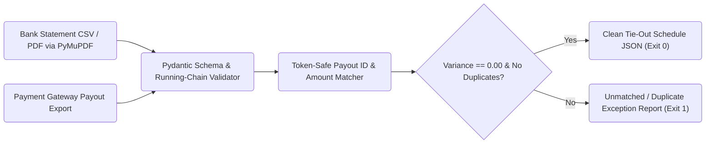

# Bank & Payment-Gateway Tie-Out Validator

Deterministic Python + Pydantic reconciliation validator that proves mathematical parity across synthetic bank statement CSV/PDF exports, Stripe gross-to-net payouts, and General Ledger clearing balances down to `$0.00` variance.

> **Synthetic Test Data Notice:** All merchant IDs, payout references, dates, and monetary amounts in `fixtures/` are 100% synthetic test fixtures. Zero confidential client or employer data is included.

## Why It Exists

SME accounting closes frequently break when payment gateway settlements (Stripe, PayPal, Square) are booked at net bank deposits instead of gross sales less processor fees. Across hundreds of monthly payouts, small timing offsets and duplicate credits accumulate in Undeposited Funds or clearing suspense.

This validator enforces three hard invariants before period lock:
1. **Per-line statement checksum:** Every `BankRow` verifies `opening_balance + amount == closing_balance`.
2. **Continuous running-balance chain:** Every row's `opening_balance` must equal the prior row's `closing_balance`.
3. **Gross-to-net gateway parity:** Every `GatewayPayout` verifies `gross_amount - processor_fee == net_payout` and ties 1-to-1 against bank deposit credits with zero missing or duplicate settlements.

## Architecture Flow



## Quick Start

```bash
pip install -r requirements.txt
python -m src.tieout_validator --bank fixtures/synthetic_bank_stmt.csv --gateway fixtures/synthetic_stripe_payouts.csv
python -m pytest -v
```

### Sample Output (`fixtures/`)

```json
{
  "bank_rows": 4,
  "gateway_payouts": 2,
  "matched_payouts": 2,
  "unmatched_gateway_ids": [],
  "duplicate_gateway_ids": [],
  "total_gateway_gross": "8215.00",
  "total_gateway_fees": "244.50",
  "total_gateway_net": "7970.50",
  "total_bank_gateway_credits": "7970.50",
  "variance": "0.00",
  "passed": true
}
```

## Author

**Waheed Ahmad** — CA-CAF Qualified (ICAP) | ACCA Finalist | Financial Controller & Accounting Automation  
[LinkedIn](https://www.linkedin.com/in/waheed-ahmad-finance/) · [GitHub Profile](https://github.com/waheedca321)
